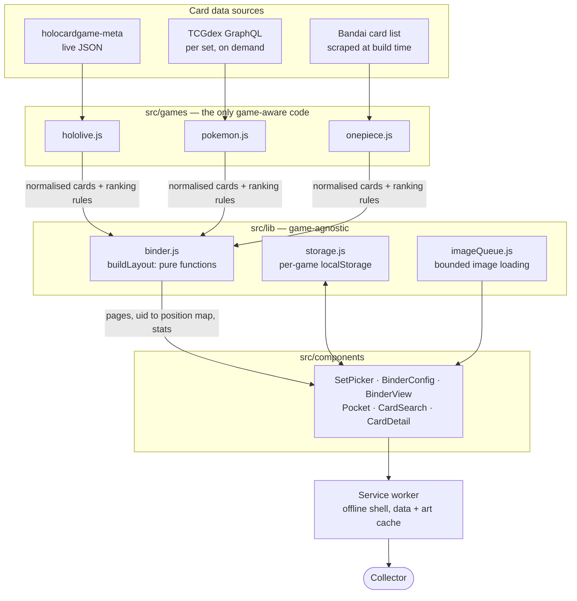

# 🗂️ Binder Position — TCG Binder Planner

> An offline-capable web app that works out **exactly which pocket every card goes in**, across three trading card games — then tells you where a card in your hand belongs: *Sheet 5 · Front · R1 C3*.

**Status:** Private repository — source code available on request (interviews, review, collaboration).

---

## What it does

Collectors sort cards into ring binders and then forget what belongs where. This turns that into a solved problem.

1. Pick a **binder size** — 3×3, 4×4, 5×4 and others, single- or double-sided sheets.
2. Pick a **set** — 35 Hololive products, 203 Pokémon sets back to Base Set, or 62 One Piece products.
3. The app lays the entire set out **sheet by sheet, pocket by pocket**, in whatever order you want: set number, rarity, colour, card type or name — with optional page breaks so each rarity or colour starts on a fresh page.
4. Hold a card, **search it**, and get its exact address. If it is not in the open binder, the app searches every other set and jumps you there.
5. **Tick off what you own.** Missing cards grey out, so the gaps in a binder are visible at a glance.

It is deliberately a *planning* tool rather than a collection tracker: the output is a physical layout you can follow while sleeving cards, and it prints cleanly as a checklist.

---

## Tech stack

**Frontend**
- React 19 + Vite 7
- Tailwind CSS 4
- ~3,100 lines across 19 modules — no UI framework, no state library

**Offline / delivery**
- Progressive Web App via `vite-plugin-pwa` (Workbox) — installs to a home screen and runs with no network
- Service-worker caching split by purpose: precached app shell, `CacheFirst` for card art with an eviction cap, `StaleWhileRevalidate` for card data
- Deployed on Vercel, with cache headers that force the service worker to revalidate

**Data — no backend, no API keys, no accounts**
- **Hololive:** community `holocardgame-meta` database, fetched live
- **Pokémon:** [TCGdex](https://tcgdex.dev) GraphQL — a whole set with rarity and print variants in one ~50 KB request
- **One Piece:** Bandai's official card list, scraped at build time into a static file (62 products, 4,915 prints)
- Everything the user creates lives in `localStorage`, namespaced per game

**Tooling**
- Node scripts for icon generation (`sharp`) and the One Piece data sync
- Git / GitHub, Vercel CLI

---

## Architecture

The shape that matters: **every game-specific fact lives behind one provider interface.** The layout engine and all six components work on a normalised card shape and a `rules` object of ranking functions. Adding a game is one new file plus a line in the registry.

---

## Key engineering details

- **The layout engine is pure.** `buildLayout(cards, config, rules)` takes a flat card list and returns one entry per binder *side*, a `uid → position` map, and stats. No React, no game knowledge. It holds invariants — every side padded to exactly `cols × rows`, every card placed exactly once, no group ever interleaved — verified across every sort × grouping × grid combination for all three games.

- **"Set" turned out to mean two different things.** A booster pack does not only contain cards numbered to it: a Hololive hBP02 pack also holds ten yell cards from a separate numbering series, and One Piece boosters carry special-art reprints of older sets. The picker therefore offers *pack contents* or *card numbers*, and they genuinely differ — hBP02 is 162 prints one way and 221 the other.

- **Grouping has to reorder.** "New page per rarity" while sorted by card number would start a fresh page every time the rarity changed — 201 pages for one set. The group key sorts first; the chosen sort applies *within* each group.

- **A pocket per print, not per card.** Master-set collectors need a slot for every physical printing. Hololive encodes these in image filenames (with inconsistent token order), Pokémon reports them as boolean `variants` flags that get expanded, One Piece encodes them in the card id. Pokémon's *Surging Sparks* is 252 card numbers but **422 pockets**.

- **Image loading is a bounded queue, not `loading="lazy"`.** A 400-pocket page makes browsers fire 130+ concurrent requests, and the card-art hosts simply stop answering — pockets stay blank forever. Six at a time, each slot released after 15 s at the latest. `IntersectionObserver` was tried first and rejected: it does not fire while a tab is not compositing, which fails in the worse direction.

- **Data sources were chosen on CORS, not features.** The most complete One Piece APIs send no `Access-Control-Allow-Origin` header at all, and the one that does needs a secret key a client-side app cannot hold. The community dataset that remained recorded a release *wave* rather than a pack — merging two products into one unusable set. The fix was to scrape the publisher's own card list at build time.

- **Collections are portable.** Everything lives in one browser, so there is a save/load file with explicit *merge* (never loses local data) and *replace* (restores a backup exactly) semantics — plus a one-time migration for keys written before multi-game support.

---

## Interested in the code?

The repository is private. If you would like to see the source — the layout engine, the provider abstraction, or a walkthrough of how the data problems were diagnosed — feel free to reach out.
